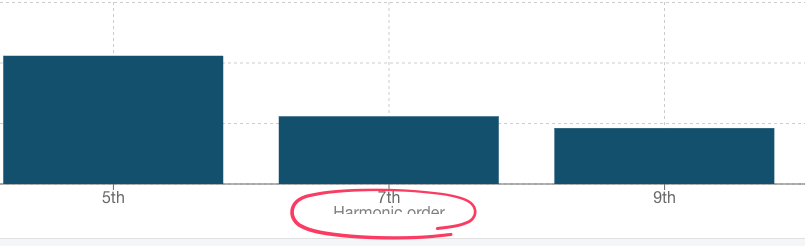
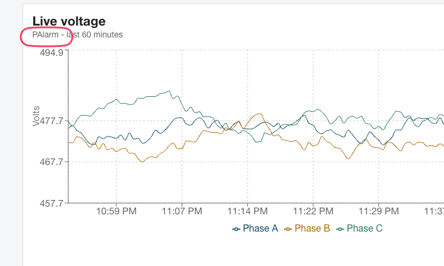
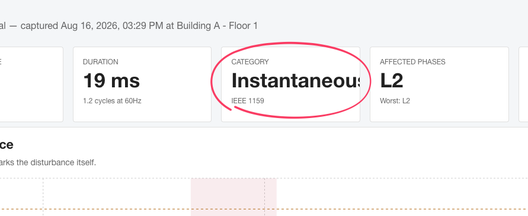
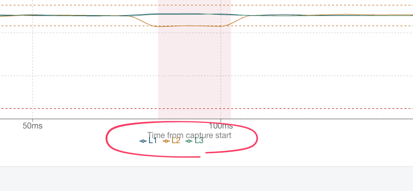
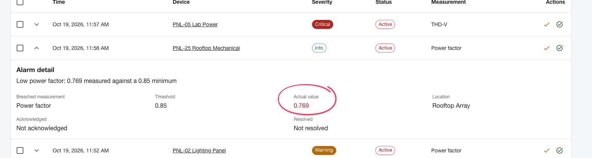
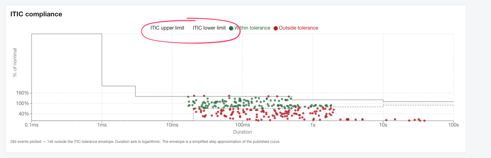

# Bug Report – Power Quality Monitor

---

## Bug 1: Truncated UI Label / Text Overlap in Harmonic Spectrum Chart

**Severity:** Low (UI / Visual Defect)

**Description:**
On the device detail page → click for any device details, under the Harmonic spectrum chart, the x-axis label reads "Harmonic order", but the full text gets clipped by the container border line.

**Expected Result:**
Clean padding and no text clipping should be shown.

**Screenshot:**

---

## Bug 2: Dashboard – Recent alarm status for any device showing mismatch value on device page

**Severity:** High (Functional)

**Description:**
Alarm status shown on Dashboard side panel is not matching the value for the related device shown on device detail page.

**Steps to Reproduce:**
1. On Dashboard → side panel, check for any device's alarm status.
2. Click that related device to check the alarm.
3. On the device readings page, alarm status shown differs from the status shown on the Dashboard panel.

> **Note:** This mismatch status is observed for every device item shown on Dashboard side panel.

**Expected Result:**
Alarm value shown for the device on Dashboard should be same on the related device's detailed page.

---

## Bug 3: Dashboard – Live voltage graph always shows live data for PAlarm device

**Severity:** High (Functional)

**Description:**
On Dashboard, Live Voltage graph is always shown only for 1 device `PAlarm`. (Also listed as a feature request in [test_report.md](test_report.md) – 3.1.)

**Steps to Reproduce:**
1. On Dashboard, observe the graph and notice the device name shown in graph.

**Expected Result:**
An option for selecting the device to show the respective graph should be shown.

**Screenshot:**

---

## Bug 4: Events Detail page - category 'Instantaneous' is getting clipped

**Severity:** Low (UI)

**Description:**
On Events list table, click an event with Category as 'Instantaneous' and observe the value is clipped in the events detail page.

**Expected Result:**
Category value 'Instantaneous' should be handled properly without clipping the text.

**Screenshot:**

---

## Bug 5: Events Detail page - x-axis text on the RMS graph

**Severity:** Medium (UI)

**Description:**
On Events detail page -> RMS voltage graph, x-axis values are overlapped by L1, L2, L3 phase markers.

**Expected Result:**
Graph x-axis text and markers should not overlap. Proper spacing should be handled.

**Screenshot:**

---

## Bug 6: Alarms – Info severity alarm values shown in red

**Severity:** High (UI & Functional)

**Description:**
In Alarms tab -> all alarms list table, some alarm items show 'Critical' severity and their expanded detail shows the related breached value in red. But for 'Info' severity items the values are also shown in red, even though no threshold is breached.

**Expected Result:**
For Severity 'Info' items, the related values should not be shown in red if there is no threshold breached.

**Screenshot:**

---

## Bug 7: Power quality events - ITIC chart

**Severity:** Medium (UI & Functional)

**Description:**
In the ITIC Compliance chart, the markings for the 'ITIC upper limit' & 'ITIC lower limit' are not clearly marked on the chart. This makes it unclear whether a value on the graph is near the upper or lower limit.

**Expected Result:**
The markings for upper & lower limit should be clearly marked or defined in the chart.

**Screenshot:**

---